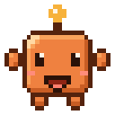

# Mochi – a tiny companion for claude.ai

Mochi is a tiny square, orange pixel-art companion (a retro 8-bit style game character) that sits beside your claude.ai chat and reacts to the conversation. It is a personal Chrome extension: it runs only on `https://claude.ai/*`, it does all its work inside your browser, and it never sends anything anywhere.



## Install in Chrome (about 1 minute)

1. **Get the folder onto your computer.** Download `mochi-extension.zip` and unzip it. You now have a folder called `mochi-extension` containing `manifest.json`.
   Keep the folder somewhere permanent, such as your Documents folder: Chrome loads Mochi from it every time it starts.
2. Open Chrome and go to **`chrome://extensions`** (type it in the address bar).
3. Turn on **Developer mode** (the switch in the top-right corner).
4. Click **Load unpacked** (top-left) and select the `mochi-extension` folder, the one that contains `manifest.json`.
5. Mochi appears in the list as **"Mochi – a tiny companion for Claude"**. Optional: click the puzzle-piece icon in the toolbar and pin it.
6. Open or reload **https://claude.ai**. Mochi pops in at the bottom right and waves hello.

Works the same in Edge (`edge://extensions`, then "Developer mode" and "Load unpacked"), Brave and other Chromium browsers.

**Update after changing the files:** on `chrome://extensions`, click the circular arrow on Mochi's card, then reload claude.ai.
**Turn it off:** use the switch on Mochi's card. **Remove it:** click "Remove".

## Mochi on other websites (toolbar button)

On claude.ai Mochi appears by itself. On **any other website**, click Mochi's icon in Chrome's toolbar (pin it first: puzzle-piece icon → pin next to Mochi):

- **First click** on a page: Mochi pops in and waves.
- **Next click:** Mochi hides. **Click again:** it comes back.
- On claude.ai the same button hides Mochi or brings it back.
- Mochi stays on that page until you reload it or go to another page. Click again there to bring it along.
- Chrome doesn't let extensions onto its own pages (`chrome://…`, the Chrome Web Store, the new-tab page). There the icon shows a small **×** for a moment.

On other websites Mochi doesn't follow a chat. It glances at the box when you type, stays calm while you scroll and read, and falls asleep after 5 quiet minutes. Clicking, dragging, hearts and tucking away all work as on claude.ai. **It reads no text on those pages:** the mood reading runs only on claude.ai.

## How Mochi looks

A 16 × 15 pixel square body with stepped corners, small square arms and legs, a little amber spark on top, and a flat orange and amber palette with no gradients. It's drawn with crisp edges, and every animation moves by whole pixels in held frames, like an 8-bit or 16-bit game sprite. At 120 px (80 px on small windows), each art pixel is exactly 3 (or 2) screen pixels.

## What Mochi does

| In the chat | Mochi |
| --- | --- |
| You send a message | **Curious**: leans toward your message and looks at it, with a pixel "?" |
| Claude starts answering | **Thinking**: looks up, taps its head with one arm, shows a pixel thought bubble |
| Claude is writing | **Focused**: watches the reply, nods gently, blinks |
| Claude finishes | **Happy** (bounces, sparkly eyes), **Excited** (jumps, waves both arms, sparkles), **Surprised** (wide eyes, a little jump) or **Sad / empathetic** (worried brows, a pixel tear and a small heart), depending on the mood of the conversation |
| You're quiet for 2 minutes | **Neutral** idle: blinks, breathes, and now and then looks around, stretches, hums ♪, waves or gets excited about nothing |
| You're quiet for 5 minutes | **Sleeping**: eyes closed, slow breathing, floating pixel Zzz |
| You start typing | Glances at the message box; if asleep, wakes up with a stretch and a yawn |
| You start a new chat | Waves hello |

**Playing with Mochi**
- **Click** (or Tab to it and press Enter): a random reaction, such as a hop, a spin, a wave, hearts or a surprised jump. Click very fast and Mochi gets dizzy.
- **Drag** to move it anywhere; it remembers the spot. **Double-click** sends it back to its automatic spot beside the message box.
- **Hover** to see its name tag and mood, and a small **–** button that **tucks Mochi away** to the edge of the window. Click the peeking Mochi to bring it back.
- When your pointer comes close, Mochi's eyes follow it.

**Fitting in**
- Mochi sits in the empty space to the right of the message box. On narrow windows it shrinks and perches just above the box, so it never covers messages, the input or its buttons.
- It matches claude.ai's light or dark theme.
- It stays calm while you're reading (no idle antics for 10 seconds after you scroll), and pauses its animations when the tab is in the background.
- If your system has **Reduce motion** turned on, Mochi keeps its expressions but stops bouncing, jumping and floating.

## Privacy

- **Permissions:** `storage` (Mochi's position and whether it's tucked away), plus `activeTab` and `scripting` for the toolbar button. With `activeTab`, Chrome lets the extension touch a page only after you click its icon on that page, and only that tab. It runs by itself only on claude.ai, and has no access to cookies, history, other tabs or sites you didn't click it on.
- **No network:** the code makes no network requests at all (no `fetch`, XHR, WebSocket or beacons).
- **Your messages:** Mochi reads the newest message on the screen once, in memory, to choose a face with a small built-in word list (English, Russian, Armenian). It never stores, logs or sends message text.
- **Read-only:** it never clicks, types or changes anything in the chat. It lives in a closed Shadow DOM, so its styles can't affect claude.ai and claude.ai's can't affect it.

## If Mochi stops reacting

claude.ai changes its page from time to time. Mochi recognises the chat by a few markers (your messages, the "Stop response" button, the reply being written), all listed in **`src/config.js` → `selectors`**. If Mochi still appears but no longer reacts to messages, that list is the only thing that needs updating. The chat itself is never affected either way.

## Files

| File | What it does |
| --- | --- |
| `manifest.json` | Chrome extension manifest (Manifest V3): runs by itself on claude.ai, elsewhere only when you click its icon |
| `src/config.js` | Page selectors, timings, chattiness and speech-bubble phrases: the settings worth tweaking |
| `src/sentiment.js` | Local mood reading of the conversation (word lists, punctuation, emoji) |
| `src/art.js` | Mochi's pixel-art sprites (a 40 × 40 grid: body, arms, legs, every eye, mouth and effect), the palette, and the face recipe for each mood |
| `src/styles.js` | All animations as stepped, whole-pixel sprite frames (moods, actions, effects), plus retro bubble and tag, responsive sizes, dark theme and reduced motion |
| `src/companion.js` | Draws Mochi, blinking, speech bubble, eye-follow, drag, tuck, click |
| `src/mood-engine.js` | Turns chat events into moods, plus idle life and sleep |
| `src/chat-watcher.js` | Watches the claude.ai page (read-only) and reports chat events |
| `src/content.js` | Starts everything and keeps Mochi out of the way of the message box |
| `src/background.js` | The toolbar button: brings Mochi to the current page, hides it or shows it |
| `icons/` | Extension icons |
| `test/test-page.html` | A local stand-in for the claude.ai chat with buttons for every mood and action |
| `test/mochi-demo.mp4` | A recording of Mochi on the test page |

### Try the test page

```bash
cd mochi-extension
python3 -m http.server 8765
```

Then open http://localhost:8765/test/test-page.html. The left panel switches moods, plays actions, sends simulated happy, sad and surprising messages, starts a new chat, puts Mochi to sleep and toggles dark mode. These test controls work only on `localhost` and local files, never on claude.ai.
