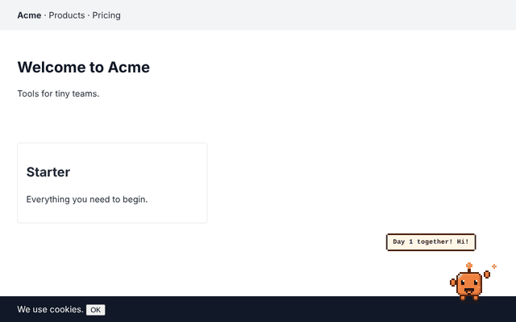
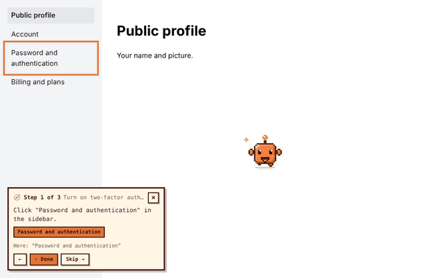
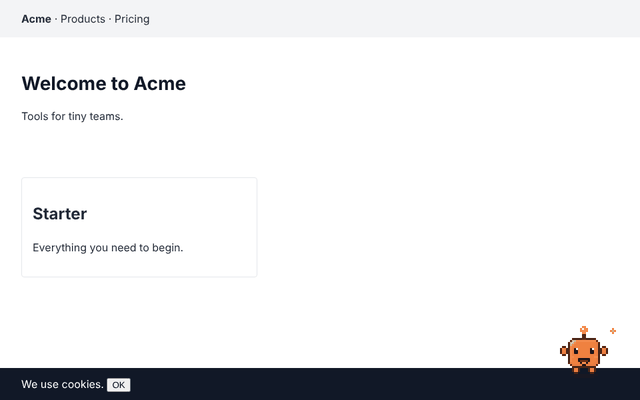
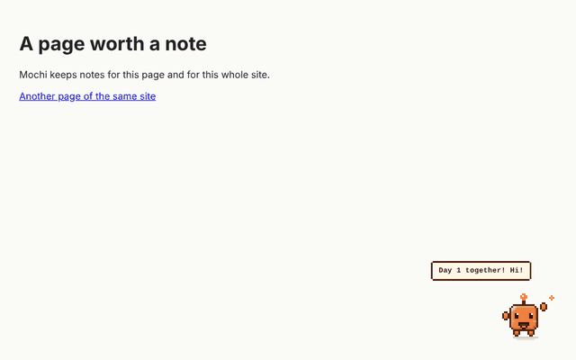
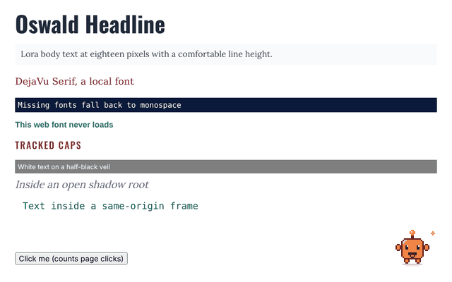

# Mochi – a tiny companion for claude.ai

Mochi is a tiny square, orange pixel-art companion (a retro 8-bit style game character) that sits beside your claude.ai chat and reacts to the conversation (and on ChatGPT and Gemini too, [if you turn them on](#chatgpt-and-gemini-v126-optional)). Click it to **[let Claude change any page live, follow Claude's steps as a guide on the real site](#live-edit-guides-and-your-design-taste-v130)**, take **[notes on any site, pick colors or inspect fonts](#three-little-tools-notes-color-picker-font-inspector-v129)**, **scan the UI of any page** into a ready-to-paste AI prompt, a DESIGN.md, CSS variables, a Tailwind theme or JSON tokens — or run a **[Deep scan](#deep-scan-a-rebuild-spec-of-any-page-v127)** that turns the page into a full rebuild spec for an AI coding agent. Right-click any picture for an **[Image scan](#image-scan-colors-text-font-and-an-ai-prompt-v128)**: its palette, the text in it, the font style, what it shows, and a ready AI image prompt. It is a Chrome extension that does all its work inside your browser and sends nothing anywhere, except for the optional [online friends](#online-friends-v125-optional) when you turn them on.


## ⬇️ Download

### **[Download Mochi (mochi-extension.zip)](https://github.com/inileyt/mochi_claude/releases/latest/download/mochi-extension.zip)**

Always the newest version. All versions and what changed: **[Releases](https://github.com/inileyt/mochi_claude/releases)**.
Step-by-step install guide in English, Հայերեն and Русский: **[INSTALL.md](INSTALL.md)**.

## Install in Chrome (about 2 minutes)

1. **Download** the zip above and **unzip it** (double-click on Mac; right-click → *Extract All…* on Windows). You get a folder called **`mochi-extension`** with `manifest.json` inside.
   Keep the folder somewhere permanent, such as your Documents folder: Chrome loads Mochi from it every time it starts.
2. Open Chrome and go to **`chrome://extensions`** (type it in the address bar).
3. Turn on **Developer mode** (the switch in the top-right corner).
4. Click **Load unpacked** (top-left) and select the **`mochi-extension`** folder.
5. Mochi appears in the list as **"Mochi – a tiny companion for Claude"**. Optional: click the puzzle-piece icon in the toolbar and pin it.
6. A **welcome page** opens: say hi, pick Mochi's color and (if you like) a name, choose which chat sites Mochi lives on, then press **Open claude.ai**. Mochi pops in at the bottom right, waves hello and shows you around in three little cards.

Works the same in Edge (`edge://extensions`, then "Developer mode" and "Load unpacked"), Brave and other Chromium browsers.

**Update to a new version:** download the new zip, unzip it over the old `mochi-extension` folder (replace the files), then click the circular arrow on Mochi's card at `chrome://extensions` and reload claude.ai. Your level, outfits and settings stay.
**Turn it off:** use the switch on Mochi's card. **Remove it:** click "Remove".

**For maintainers:** bump `version` in `manifest.json` and push to `main`. GitHub Actions (`.github/workflows/release.yml`) runs the tests, builds the zip (`dev/build-zip.sh`) and publishes the release; the download link above always points to the newest one. To describe a release in your own words, add `release-notes/<version>.md` (otherwise the notes list the commits since the last release).

## The menu

Click Mochi to open its little pixel app. It has five sections, switched with the tabs (or ← → keys):

- **☻ Mochi:** Scan this UI, Pick an element, Pocket, Play (the old click-to-play reactions)
- **♛ Wardrobe**, **♥ Friends**, **✦ Tools:** fill up as features arrive
- **⚙ Settings:** language, idle antics, "Back to my spot", and an on/off switch for every feature

Double-click Mochi to send it back to its spot; Esc or a click elsewhere closes the menu.

## Wardrobe (v1.6)

Mochi can dress up. Open the menu → **♛ Wardrobe** and click an item to put it on or take it off (one per slot: head, face, neck, and clothes since 1.32): Santa hat, scarf, bow, sunglasses, headphones, wizard hat, and [15 more since 1.32](#new-friends-and-a-bigger-wardrobe-v132). Locked items show as silhouettes with the level that unlocks them. Accessories are drawn inside Mochi's own sprite, so they follow every hop, spin, nap and face.

**Winter:** from Dec 15 to Jan 7 (your local date) Mochi wears the Santa hat and scarf by itself, with pixel snow falling around it. Your own picks win, and **Settings → Seasonal outfit & snow** turns it off.

All accessories live in `src/outfits.js` in one simple format (see the top of that file).

## Levels, XP and streak (v1.7)

Mochi grows with you, counted only in your browser:

- **XP** for a claude.ai conversation turn (10), a scan (8), a pick (5), petting/playing (2), the first visit of a day (15) and each streak day (+5 per day in a row, up to 50). Turns, scans, picks, pets and mini-game stars share a cap of 120 XP per hour, so it can't be spammed. The numbers live in one table at the top of `src/progress.js`.
- **Level-ups** get a celebration (a jump, waving arms, sparkles, "Level 5!") and unlock things: outfits, friends, and new idle antics (yawning at 4, juggling a star at 5, reading a tiny book at 7).
- **Daily streak:** the first visit of the day says "Day 7 together!". Skip a day and Mochi is a little sad for a moment, then starts again happily.
- The **stat card** (menu → ☻ Mochi) shows the level, an XP bar, the streak and the next unlock. **Share card** downloads a PNG (Mochi in the current outfit, level, streak and `github.com/inileyt/mochi_claude`) for social media.

**Settings → Levels, XP & streak** turns all of it off.

## Friends (v1.8)

Menu → **♥ Friends**. Choose **who you are** (Mochi, the cat, the robot or the ghost, and [five more since 1.32](#new-friends-and-a-bigger-wardrobe-v132)) and a **friend beside you**. Friends unlock with levels: bunny at 2, cat at 3, penguin at 4, fox at 5, robot at 6, bear cub at 8, ghost at 10, cloud at 12.

- **Cat:** lazy (never more than "happy"), naps while Claude writes, falls asleep after a minute of quiet, and now and then knocks a cup over.
- **Robot:** beeps, and gets very excited when Claude's answer has code in it ("BEEP BOOP! CODE!").
- **Ghost:** shy (fades when your pointer comes close), drifts in and out, and gets spooky with a purple glow at night (9 pm – 6 am).

Each character only defines its body, colors, phrases, how it shows moods and its own antics, in `src/characters/<name>.js`; the mood engine, faces, animations and outfits are shared. With a friend beside Mochi, the two wave hello, the friend copies Mochi's jumps, they look at each other, and both react to the chat in their own way. If there's no room beside Mochi (on claude.ai the friend never covers the message box), the friend sits on top.

## 8-bit sounds (v1.9)

Tiny chiptune sounds made in code with the Web Audio API (no audio files): a hop blip, a happy jingle, a sad note, a level-up fanfare, a sleepy snore, the cat's purr and the robot's beeps. **Off by default:** Settings → 8-bit sounds, with a volume slider. They never play before you've clicked or typed on the page (the browser's autoplay rule), only one plays at a time, and each waits a few seconds before it can play again, so they never get annoying.

## Prompt coach (v1.10)

On claude.ai, when you stop typing in the message box for about 1.5 seconds, Mochi glances at your draft and, if it looks thin, makes a thinking face and offers **one** gentle tip, such as "What should it fix, and how?", "Paste the error message too?" or "Tell Claude what it's for, or who it's for?". It understands English and Russian drafts, gives at most one tip per draft, never blocks sending and never touches your text. The rules and tips are a small table at the top of `src/prompt-coach.js`, easy to edit. Turn it off in Settings → Prompt tips.

## Long-chat warning (v1.11)

Very long chats get slow and use up your limits faster. On claude.ai, after each answer Mochi counts the messages and characters on the screen and grows tired as the chat gets long: droopy eyes first, then a yawn now and then, then little bags under the eyes. Once per conversation it offers **Copy summary prompt**, a ready prompt asking Claude to sum up the chat so you can carry on in a new one, or **Not now**. Mochi only copies the prompt; you paste and send it yourself. The thresholds are a small table at the top of `src/long-chat.js`. Turn it off in Settings → Long-chat warning.

## Colors (v1.12)

Wardrobe → Colors: dress Mochi in **orange** (the classic), **mint**, **sakura**, **matcha**, **blueberry**, **lemon** or **night**. Each friend gets its own color choice too, starting from its own classic look. A color theme sets the body colors by role (outline, shade, base, light, highlight, accent, eyes), so every pose, outfit and effect follows, and the share card shows Mochi, the friend and the palette in the chosen colors. Themes are a small table in `src/colors.js`.

## "Claude answered" badge (v1.13)

Ask Claude something and switch to another tab: when the answer is done, the claude.ai tab gets a **✓** in front of its title and a tiny pixel Mochi with a green check as its icon, so you can spot it in the tab strip. When you come back, the title and icon go back to normal and Mochi welcomes you. It uses no browser notifications and asks for no permission. Turn it off in Settings → "Claude answered" badge.

## Catch the stars (v1.14)

When Claude takes a while, Mochi asks **"Play while you wait?"**. Say yes and a small pixel window opens above Mochi: move with the mouse (or ← → after clicking the game) and catch falling stars for 30 seconds; gold stars are worth 3. Mochi remembers your best score, and each star gives a bit of XP (at most 15 a round, within the hourly cap). The game only runs while its window is open, never takes the keyboard away from the chat box, and is also in the menu as **Catch stars**. Turn the question off in Settings → "Play while you wait?".

## Prompt library (v1.15)

Menu → Tools → **Prompt library** keeps the prompts you use again and again. On claude.ai, **Save the message box** keeps what you've typed, with a name and tags; or write a **New prompt** by hand. Search by words, by name or by `#tag`. **Insert** puts a prompt into claude.ai's message box, the same way a paste would, and never sends it: you press Enter yourself. On other sites the button is **Copy**. **Export** saves everything as a JSON file and **Import** adds prompts from one, skipping any you already have:

```json
{ "mochi": "prompt-library", "v": 1, "prompts": [{ "name": "Code review", "tags": ["code"], "text": "Review this code for bugs…" }] }
```

## Answer bookmarks (v1.16)

On claude.ai, hover one of Claude's answers and a little pixel pin appears just beside it: press it to bookmark that answer. Mochi keeps the chat's address, its title, the first lines of the answer and the date. Menu → Tools → **Bookmarks** lists them; **Open** goes to that chat and scrolls to the answer by finding those first lines again, with a blinking frame around it. **Bookmark the last answer** in the same menu does it from the keyboard. The pin is drawn in Mochi's own layer, so the claude.ai page is never changed. Turn the pins off in Settings → Bookmark pins.

## Export a chat to Markdown (v1.17)

On claude.ai, Menu → Tools → **Export chat (.md)** saves the conversation on the screen as a Markdown file: your messages and Claude's answers in order, with Claude's formatting kept (headings, lists, code blocks with their language, tables, quotes, links, bold and italic). The file is made in the page and downloaded directly (a Blob), with nothing sent anywhere.

## Focus mode (v1.18)

Menu → Mochi → **Focus (Pomodoro)** starts 25 minutes of focus, then a 5-minute break, round after round until you press **Stop focus** (or the × on the timer). While you focus, Mochi wears little reading glasses, keeps quiet (no idle antics) and shows a small timer badge. Each phase gets exactly one bubble: "Break time!", then "Back to it! Round 2". The start time is saved, so the timer keeps going across reloads and is the same in every tab. Change both lengths in Settings → Focus length / Break length.

## Explore mode (v1.19)

Now and then, when nothing is going on, Mochi goes on a little trip: a walk along the bottom edge of the window, or a hop up to sit on a heading or a picture for a moment, and then home again. It only goes where it covers no text and no controls (links, buttons, fields), checked point by point along the way. It comes straight home when your mouse comes near, when you scroll or type, when the chat moves or when a menu opens. It never explores in focus mode, with Reduce motion on, or while tucked away. **Off by default on claude.ai** and on elsewhere: Settings → Explore the page. Your chosen spot for Mochi is never changed.

## Secrets (v1.20)

There are secrets… 🤫 Be nice to Mochi, be curious, and maybe try a code from an old game.

## Make your own outfit (v1.21)

Wardrobe → **Outfit editor**: draw an accessory on Mochi's 40×40 grid with Mochi's own palette. The first six colors are Mochi's body colors, so your outfit follows his color theme. Undo with the button or Ctrl+Z, see it on Mochi in six moods, or press **Try on** to watch the real Mochi hop, spin and nap in it. **Save to my wardrobe** keeps it in this browser and it shows up in the wardrobe right away. **Export JSON** gives the exact format below, with you as the author. To share it with everyone, see [CONTRIBUTING.md](CONTRIBUTING.md).

### Outfit format

Every accessory in `src/outfits.js` is plain data:

```js
{
  id: 'party-hat',                 // unique, lowercase-with-dashes
  name: 'Party hat',               // shown in the wardrobe (or a locale key like 'outfit.party-hat')
  author: 'Your name',             // who drew it
  slot: 'head',                    // 'head' | 'face' | 'neck' | 'body' (clothes) — one item per slot
  unlock: { level: 3 },            // the level that unlocks it
  season: 'winter',                // optional: worn automatically Dec 15 – Jan 7
  hide: ['antenna'],               // optional: parts of Mochi it covers
  at: [14, 9],                     // top-left on Mochi's 40×40 grid
                                   // (body: x 12–27, y 17–31 · eyes: y 22–24 · antenna: y 11–16)
  pixels: ['.....GG', '....RRRR', 'OOOOOOOOOOOO'],   // one character per pixel, '.' is empty
  palette: { G: '#ffe08a', R: '#ff6f8e', O: '@outline' },
                                   // a hex color, or '@role' for Mochi's own colors
                                   // (@outline @shade @base @light @highlight @accent)
  back: { at: [8, 18], pixels: [...] },  // optional: a part drawn behind the body (a cape)
}
```

Accessories are drawn inside Mochi's own sprite groups, so they follow every pose and animation.

## Languages (v1.22, more in v1.23)

Mochi speaks **11 languages**: English, Deutsch, Español, Français, Հայերեն (Armenian), Italiano, 日本語, Português, Русский, Українська and 简体中文. Everything is translated: menus, settings, bubbles, prompt tips and the friends' own lines. Mochi follows your browser's language, and you can pick another one in Settings → Language. Texts live in `src/locales/<code>.js`. To add a language, see [CONTRIBUTING.md](CONTRIBUTING.md); `node test/locales.test.js` lists any missing keys. The prompt coach's checks for weak drafts understand English and Russian; in other languages its tips show in your language but it doesn't spot weak drafts yet.

## Online friends (v1.25, optional)

Make friends with other people's Mochis. **Off by default**; it needs a small Firebase project (see [online/SETUP.md](online/SETUP.md)), and then each person turns it on in Menu → Friends → Online friends after reading exactly what is shared.

- **Your Mochi code** (`MOCHI-XXXX-XXXX`): give it to a friend, or type theirs → they get a **friend request** → Accept / Decline / Block.
- **Chat**: write to each other in Mochi's chat; from friendship level 2 there are stickers.
- **Visits**: when a friend writes, **their Mochi visits your screen** in their own colors and outfit, waves, and says the message.
- **Friendship level**: messages and using Mochi on the same day (+10 when you're both there) grow a shared level; level 3 brings a little dance on visits, level 5 unlocks a matching **friendship scarf** for both.
- **Control**: unfriend, block, turn off, or **delete all your online data** (your code, card, requests, friendships, messages and the anonymous account).

How it works: the network part lives only in the extension's background worker (`src/online-api.js`, plain `fetch` to Firebase's REST API, no SDK, no remote code). Access is guarded by [`online/firestore.rules`](online/firestore.rules): only the two friends can read their messages, a friendship needs an accepted request, nobody can write as someone else, and shared XP can only grow a little at a time. The rules and the client are tested against the Firebase emulators (`test/online-rules.emulator.js`).

## ChatGPT and Gemini (v1.26, optional)

Mochi lives beside your claude.ai chat out of the box. It can also keep you company on **ChatGPT** (chatgpt.com) and **Gemini** (gemini.google.com), if you turn them on:

1. Click Mochi → **⚙ Settings → Chat sites (ChatGPT, Gemini)…** (or `chrome://extensions` → Mochi → **Details → Extension options**, or step 3 of the welcome page).
2. Flip the switch next to ChatGPT or Gemini.
3. Chrome asks: *"Read and change your data on chatgpt.com?"* Press **Allow**. That's Chrome's standard wording for "Mochi may run on this site". Mochi uses it to see the chat on the page so it can react; it never sends, stores or types anything there.
4. Open (or reload) the site: Mochi is there, beside the message box.

Turning the switch off removes Mochi from that site and **gives the permission back** to Chrome. You can also remove it under `chrome://extensions` → Mochi → Details → *Site access*; Mochi follows that too.

On ChatGPT and Gemini Mochi reacts to your messages and the answers, matches the page's light or dark theme, earns XP and offers the little game while you wait. The tools written for Claude (chat export, bookmarks, the long-chat summary prompt, the prompt coach, the library's Insert and the "Claude answered" badge) stay on claude.ai. If one of those sites changes its page so much that Mochi can't find the chat, Mochi stays on the page as a plain companion (no reactions) and the chat is never affected; the markers it looks for are in `src/sites/chatgpt.js` and `src/sites/gemini.js`.

## Settings that follow you (v1.26)

If you're signed in to Chrome with sync turned on, Mochi's **settings, color and name, level, XP and streak, unlocked items and birthday** travel to your other computers through Chrome's own sync (`chrome.storage.sync`). When two computers disagree, Mochi keeps the higher XP, level and streak, all unlocked items, and the newest choice for each setting. The pocket, the prompt library, bookmarks and online-friends data stay on each computer. Not signed in? Then everything simply stays in this browser, as before.

## Welcome page and tour (v1.26)

After installing, a welcome page opens (4 steps, with Back / Next / Skip): Mochi says hi, you pick its color and an optional name (Mochi uses it in some of its lines), choose the chat sites, and open claude.ai. The first time Mochi is in a chat, three little cards show the menu, dragging, and playing (Next / Skip). Done or skipped, the tour never comes back on its own; **Settings → Replay the tour** shows it again. After an update, Mochi tells you once what's new.

## Mochi's birthday (v1.26)

Mochi remembers the day you installed it.

- **7 days, 1 month and 100 days** together: a happy bubble and a little confetti, once each.
- **Every year on that day** it's Mochi's birthday: Mochi wears a party hat all day and brings a pixel **cake with one candle per year**. Click the cake to blow the candles out. 🎂
- That day the **birthday hat** unlocks in the wardrobe, and it stays yours. It can only be unlocked on the birthday.
- **Share card**: a "1 year with Mochi 🎂" picture (PNG) with Mochi, its name and level, ready to post (thank-you card → *Save the card*, or Menu → Tools → *Birthday card* on the day).
- Installed on February 29? Mochi celebrates on February 28 in other years. Only one party per day, however many tabs are open. If you had Mochi before 1.26, it doesn't know your real install day, so it doesn't invent a birthday.

## Deep scan: a rebuild spec of any page (v1.27)

The quick **Scan this UI** reads colours, type and spacing. **Deep scan** goes much further: it studies the page you're on and writes a **Rebuild Spec**, a zip you hand to an AI coding agent (Claude Code, Cursor…) so it can rebuild the page as close to 1:1 as possible.

Click Mochi → **Deep scan (rebuild spec)** → **Start deep scan**. Mochi works for about a minute (a progress bar shows each step; **Cancel** stops it and puts the page back), then shows the results and offers the download.

**What it captures**
- **Structure:** the regions in reading order (header, hero, sections, footer, overlays, floating buttons), their layout (grid columns like `7fr 5fr`, flex, gaps), positioning (sticky, fixed, z-index) and repeated components (`Card ×6` described once).
- **Sizes:** every region's and component's box (px, % of the parent, vw/vh), padding, margin, max-width containers, ratios, radii.
- **Responsive:** the page laid out at 1440, 1024, 768 and 390 px; what changes at each width (columns, the burger menu, hidden things, heading sizes); the real breakpoints from the CSS.
- **Design tokens:** colours by role, the type scale, fonts and their `@font-face` sources (names only), spacing, radius, shadows, gradients, the site's own CSS variables.
- **Components and states:** buttons and their variants, inputs, tabs, accordions, dropdowns, modals… styled exactly (only what differs from browser defaults), with **hover / focus / active** changes and their transitions, and screenshots.
- **Clicks:** what menus, tabs, accordions, dialogs, carousels and the mobile burger do: what appears, where, how it animates in, and every way it closes.
- **Motion:** CSS animations with their `@keyframes`, transitions, JavaScript-driven motion described from samples ("moves vertically ±12px every ~3s"), the libraries it looks like (GSAP, Lottie, Swiper…), and whether the site respects reduced motion.
- **Scrolling:** a scroll timeline (the header that shrinks at 80px, cards that fade up when 15% visible with a 100 ms stagger, parallax at 50% speed, scroll-snap, back-to-top).
- **Screenshots:** the full page at the 4 widths, each section, and the states.

**In the zip:** `PROMPT.md` (instructions for the agent, with acceptance criteria), `SPEC.md` (everything, readable), `spec.json` (the same data; [schema](docs/rebuild-spec.schema.md)), `tokens.css`, `tailwind.config.js`, `screenshots/`. A short version also goes into Mochi's pocket, ready to paste into claude.ai together with the zip.

**Why Mochi has the "debugger" permission.** Some of this can't be done from inside a page: forcing a hover state, reading stylesheets from other servers, trying other screen widths, taking full-page screenshots. Chrome offers that through its DevTools connection, behind the `debugger` permission. Chrome doesn't allow that permission to be optional (asked later), so it is part of Mochi's permissions since 1.27.1; it does nothing until you press **Start deep scan**. While a scan runs, Chrome shows a bar: **"Mochi started debugging this browser"**. That's normal. The connection is made **only for the tab you scan, only during the scan**, and closed at the end, on Cancel, on errors and when the tab closes (pressing Cancel on Chrome's bar also stops the scan). Mochi uses a short list of DevTools commands only: it never runs code through it and never reads network traffic, cookies or passwords.

**It never acts for you.** During a scan Mochi never submits forms, never types, never follows links and never presses buttons that look like buying, paying, deleting, sending, logging out, subscribing or signing up (English and Russian words are checked). Only controls that open and close things are clicked, each one is closed again, and Mochi checks the page is back as it was; navigation away is blocked while the scan runs, and the scroll position is restored.

**Placeholders by default.** The spec describes structure, sizes, styles and behaviour, but **logos, brand names, pictures and the real texts become placeholders** of the same size and shape: texts keep their length, line count, font and role ("Lorem ipsum…" of the same length, the brand becomes "Brand"), pictures keep their exact size, ratio, `object-fit` and radius, and the screenshots have texts and pictures painted over. `PROMPT.md` tells the agent to use placeholder branding and not to reproduce logos or trademarks. Tick **"This is my own site — keep the original text and images"** to keep them; the box is off by default and unticked again for every scan.

**Nothing leaves your browser.** The spec is built on your computer and downloaded (or copied) by you. No server, no analytics, no AI calls.

**Honest limits.** A scan sees the front end only: no backend logic or data, nothing behind a login, only the A/B variant you see, nothing that needs real typing or dragging. The inside of canvases/WebGL, videos, iframes and third-party widgets can't be read (they're marked *approximate* with a suggestion), JavaScript motion is described from samples, and very large pages are analysed up to 5000 elements. The spec says all of this in its own "Not captured" section.

**Use it responsibly.** Rebuild for learning, prototyping and your own projects. Respect other sites' trademarks, content and font licences: the placeholders are there so a rebuild doesn't copy someone else's brand.

## Scan a video, and Scan the hero (v1.40)

Two new scanners under **Tools → Scanners**.

**🎞 Scan a video** — pick a `<video>` and Mochi reads it without touching it: real and displayed size, duration, **sources** and their types, **poster**, and the play attributes (autoplay, loop, muted, controls, object-fit…). It grabs a still frame when the browser allows (a cross-origin video's pixels can't be read, so the poster is used), writes clean `<video>` HTML to recreate it, and a prompt for Claude.

**✨ Scan the hero** — Mochi finds the big section at the top of the page (or an element you pick) and captures what makes it move: **CSS `@keyframes` animations** are kept exactly; **scroll / entrance reveals** are rebuilt as a reusable reveal animation plus an `IntersectionObserver` snippet (approximate — those are usually JavaScript-driven); and a `<canvas>` drawn in code is detected, including whether it's a **3D / WebGL scene** (Three.js and friends), with a still frame and a prompt to recreate it on a canvas.

## Responsive preview (v1.39)

A new tool under **Tools → Preview → Responsive preview**. Mochi lays the page out at **phone (390)**, **tablet (768)** and **desktop (1280)** widths the way DevTools' device mode does — it emulates the viewport, so the page's **own `@media` breakpoints really fire** — screenshots each one, and flags any width where the content **spills past the screen** (a sideways scrollbar), with how many pixels over. A **light / dark** switch re-previews in that colour scheme, and you can save any shot. It works on any page it can attach the debugger to (**claude.ai included**); the emulation is cleared and the debugger detached as soon as it finishes, so the real page is left untouched.

## Categorised Tools, and a Broken links & images scanner (v1.38)

The **Tools** tab is now a short list of **categories** — **Scanners**, **Inspect & grab**, **With Claude**, **Notes on this page** and **In this chat** — and you open one to drill into just its tools (a **‹** takes you back). It keeps the menu short and quick to scan as Mochi grows.

The first new scanner lives under **Tools → Scanners → Broken links & images**. It gives the page a quick health check, read **locally — nothing is fetched and nothing leaves your browser**: images that failed to load, images missing `alt` text (an accessibility problem), and dead links (empty, `#`, `javascript:`, and in-page `#id` links whose target isn't on the page). Click a result and Mochi scrolls to it and outlines it; copy a plain report, or hand it to Claude to fix. Links to other websites aren't fetched, so their 404s aren't checked here.

## A tidier Tools menu, and `<canvas>` support (v1.37)

The Tools menu is now grouped by what each tool does — **Look at the page** (Scan this UI, Pick an element, Color picker, Font inspector), **Capture from the page** (Scan an image, Scan animation, Copy for Figma, Deep scan), **With Claude** (Live Edit, Guides, Bug report) and **Notes on this page** — so it's easier to find what you need. Two capture tools now understand a `<canvas>` drawn in code (Canvas 2D / WebGL): **Scan animation** can't turn pixels painted by JavaScript into CSS keyframes, so it grabs a still frame and writes a prompt asking Claude to recreate it on a canvas with `requestAnimationFrame`; **Copy for Figma** exports a canvas as a picture, so canvas-based charts and logos come through. The on-device **AI model** page also shows real download progress now (an animated bar while Chrome prepares it, then a percentage), and Image Scan's text reading skips an unreadable region instead of erroring.

## New friends and a bigger wardrobe (v1.32)


**Five new characters** (Menu → ♥ Friends), as yourself or as the friend beside you. Each has its own look, lines and habits:
- **Bunny** (level 2): long ears (one bent), a pink nose and a fluffy tail that wags. Bouncy: hops twice and nibbles a carrot when bored.
- **Penguin** (4): white tummy, orange beak and feet, waddles. Gets out a fish when bored, and is extra happy in winter.
- **Fox** (5): pointy ears, a white chin and a bushy tail that swishes. Pounces, and now and then finds a long answer from Claude "very clever".
- **Bear cub** (8): round ears, a soft muzzle. Sleepy (naps after a minute and a half), and has a little honey.
- **Cloud** (12): floats instead of walking and wears its mood as weather: a **rainbow** when it's happy, a little **rain** when it's sad.

**15 new things to wear** (Menu → ♛ Wardrobe, now grouped into Hats, Glasses, Neck and **Clothes**):
- Hats: beanie, flower crown, cap, cowboy hat, top hat, crown.
- Glasses: round, heart, nerd, 3D, monocle.
- Neck: bow tie.
- Clothes, a new slot: overalls, tutu and a superhero cape that hangs **behind** Mochi.

Some are ready at level 1 (beanie, round glasses, bow tie, overalls); the others unlock as you level up. Everything works on every character and in every color theme. You can make your own clothes in the outfit editor too (slot "Clothes").

## Bug Reporter and "Copy for Figma" (v1.31)

### 🐞 Bug Reporter — a bug report that writes itself

Click Mochi → Tools → **Bug report** → **Record**, then do what goes wrong. Mochi holds his notepad and writes down **every step** (what you clicked, which fields you filled in, **never what you typed**), catches the page's **errors** (uncaught errors, console errors and warnings) and **failed requests** (address without the query string, method, status), and takes a **screenshot after each step** (Mochi hides for it, at most 15). Recording follows page loads in the same tab. Press **Stop**, add a title and what you expected, and you get the report:
- **For Claude:** a question with the steps, errors and environment, asking for the likely cause and a fix (copy, or into the pocket and paste on claude.ai).
- **For GitHub:** a ready issue in Markdown (steps, expected / actual, console, failed requests, environment).
- **.zip:** `report.md` plus the screenshots.

It uses the same DevTools connection as Deep scan, in a lighter **report mode**: nothing on the page is stopped or changed, Mochi only listens for errors and failed requests in that one tab, and the connection closes when you press Stop or Cancel, when the tab closes, or after 15 minutes. Chrome shows its "started debugging" bar while it records. Nothing leaves your computer until you copy or download it yourself.

### ◇ Copy for Figma — any part of a page as editable layers

Click Mochi → Tools → **Copy for Figma (SVG)** and pick a part of the page. Mochi rebuilds it as SVG: boxes become rectangles (fill, border, corner radius, shadow, gradients), each line of text becomes a text layer at its place (font, size, weight, color, letter spacing), pictures from the same site become images, `<canvas>` drawings are captured as a picture (PNG, since v1.37), and inline icons are copied as they are. Each element becomes a group named after it. The SVG is copied: in Figma press **Ctrl+V** (⌘V on a Mac) and it becomes **editable layers**. There is also a preview and a **.svg** download.
- Close to the page, not pixel-perfect: no animations, filters or blend modes, and pictures from other sites become gray boxes (Mochi doesn't download anything).

## Live Edit, Guides and your design taste (v1.30)

### ✨ Live Edit — ask Claude to change any page, and watch it change



Click Mochi → Tools → **Live Edit**, pick a part of the page (or the whole page) and say what should change: "bigger text", "dark mode for this site", "hide the cookie bar", "make this table easier to read". Mochi takes the question to claude.ai (you press Enter there), and when Claude answers, **Mochi carries the CSS back to your page and applies it**: before/after, edit it by hand, ask for a tweak, undo, copy — or **keep it** for this site or page.
- **Only CSS, checked first.** Mochi removes anything that would run code or load something from the web (`@import`, `url()` to other sites, `expression()`…) and tells you what it removed. Nothing is ever clicked or submitted for you.
- Kept edits come back whenever Mochi is on that site. To have them on **every** visit, even before Mochi comes, allow "Mochi on every site" (an optional permission, asked from a click on a Mochi page that explains it; turn it off there anytime).
- No API key, no server: the question and the answer travel through claude.ai, in your own chat.

### 🧭 Mochi Guides — Claude's steps, played on the real website



When Claude answers with steps ("how do I turn on two-factor login on GitHub?"), Mochi asks **"Make it a guide?"**. He opens the website and shows one step at a time: he **finds the button the step talks about, walks over and points at it**, and moves on by himself when you've clicked it or filled in the field. ← ✓ Skip, and "Can't find it" copies a question for Claude with what Mochi sees on the page. **Mochi never clicks for you.**
- **Ask Claude for a guide** (Tools → Guides) writes the question so the answer has exact button names.
- **Record a guide:** do something once, Mochi writes down what you click (and which fields you fill in, never what you type). Play it again later, or **share it as a `.mochi-guide.json` file** — a colleague imports it and Mochi walks them through.
- The guide survives page loads; with "Mochi on every site" Mochi rejoins the new page by himself, otherwise a click on his toolbar icon brings him (and the guide) back.

### 🎨 Your design taste



Everything you scan and pick with Mochi (UI scans, picked elements, image scans, picked colors, pinned fonts, kept Live Edits) leaves a small note in your browser. **Menu → My design taste** turns them into *your* taste: the colors you keep coming back to (with names), your typefaces, your vibe, light or dark, corners and spacing. One click gives Claude a **design taste brief** ("please design in this direction"), or download `TASTE.md`. Mochi wears his painter's beret for it. Settings → *Learn my design taste* turns the notes off; **Forget my taste** deletes them.

## Three little tools: notes, color picker, font inspector (v1.29)

Click Mochi → **Tools**. Each one is a little helper Mochi holds in his paws, and each one loads only the first time you use it; while it's off, it runs nothing at all. Light and dark, keyboard-friendly, and **Esc** always puts it away.

### ✎ Notes for every site



Mochi holds a little pixel notepad: notes for **this page** or for the **whole site** (one click switches). Plain text, with `[ ]` checkboxes you can tick with a click (or Ctrl+Enter); it saves by itself as you type and shows when. Pick a paper color, drag it by its top. When Mochi comes to a page that has notes, he holds up a tiny paper with the count: click it to open them.
- The page address is cleaned up first: no `#…`, no tracking bits (`utm_…`, `fbclid`, `gclid`…), so the same page always finds its note.
- **All notes:** every note grouped by site, with search, open, delete, and export / import (JSON or Markdown).
- **Send note to Claude:** on claude.ai it goes straight into the message box; elsewhere it goes into Mochi's pocket and Mochi offers it on claude.ai. It's never sent: you press Enter yourself.
- **Reminders when you come back (optional, off by default).** Normally Mochi only sees a page when he's on it. Settings → *Note reminders on revisit…* opens a short Mochi page that explains it, and only after your click asks Chrome for permission to look at the pages you open (Chrome words it "read and change your data on all websites"). With it on, a **tiny** script checks whether the page has a note in this browser and, if so, a little Mochi peeks in from the corner: "You have a note here!". It reads nothing on the page and sends nothing; the full Mochi comes only if you click him. Turning it off removes the script and gives the permission back.
- **Your notes never leave the browser.** They live in `chrome.storage.local`. With Chrome sync on, only a small list of which notes exist (titles, no text) follows you to your other computers. If the storage is full, Mochi tells you and keeps what's saved.

### ◉ Color picker


Mochi takes out a tiny pipette and leans in; pick any pixel on the screen (Chrome's eyedropper; Esc cancels). You get a big swatch and the color in **HEX / RGB / HSL / OKLCH** with a name, each with a copy button; HEX is copied right away ("Copied #F97316!").
- The last **24 colors** in a pixel strip: click to copy, drag (or Alt+←/→) to reorder, Clear. They follow you with Chrome sync.
- **Contrast check:** pick a second color, or compare with the page background: the WCAG ratio with AA / AAA for normal and large text. Mochi gives a thumbs up, or looks worried.
- Export the strip as CSS variables, Tailwind colors or JSON, or save it to the pocket.
- Browsers without the eyedropper simply don't show this tool.

### Aa Hover font inspector — **Alt+F**



Press **Alt+F** (or Tools → Font inspector): Mochi puts on his reading glasses and the pointer becomes a little magnifier. Point at any text to see the font **really used** (the whole stack, with the used one underlined, and "probably" when Mochi can't be sure), the size in px and rem, weight, line height, letter spacing, the color and its contrast with the background, and an "Aa" preview. Click to pin it, then **Copy CSS** or **Copy for AI** ("Use font Oswald at 48px/1.1, weight 700, color #1F2937"). Esc or Alt+F again stops.
- While inspecting, a clear glass covers the page: your clicks never reach it (no links open, no buttons fire), and the outline is drawn on Mochi's layer, never in the page's CSS.
- It also looks inside open shadow roots and same-origin frames.
- How it knows: a web font counts as used when Chrome has loaded it for that weight and style; a font installed on your computer is found with a quick text-measuring test; otherwise it's the browser's generic family ("probably").
- You can change the shortcut at `chrome://extensions/shortcuts`.

## Image scan: colors, text, font and an AI prompt (v1.28)

Right-click any image on any page → **Scan image with Mochi**. (Or point at a big picture while Mochi is on the page and click the little ⌕ magnifier in its corner, or Mochi's menu → Tools → **Scan an image** and click one.) Mochi takes a look with his magnifying glass, then opens a card:

| Part | What you get | How accurate |
| --- | --- | --- |
| **Colors** | Up to 8 colors (fewer when the picture has fewer) with hex, RGB, HSL, share of the area, a name ("dusty rose", "deep navy") and a role (background, dominant, accent, text); light or dark, warm or cool, how saturated; the direction and ends when it's mostly a gradient. Click a swatch to copy its hex; **Copy as CSS variables** / **Copy as Tailwind colors**. | **Exact** for flat art (the real pixel values; k-means in Lab color space), the main tones for photos. |
| **Text in the image** | The text (lines, with its areas outlined on the thumbnail), the language and a confidence; **Copy text**. "No text found" when nothing is reliable. | Good for printed **English, Russian, Armenian** and, when you turn them on, **German, French, Spanish, Italian, Portuguese, Ukrainian and Greek** (Tesseract OCR, all bundled). Pick the ones you read on the welcome page or in Settings → Image text languages; only those load, so a scan stays fast. Handwriting, tiny or very stylised letters are hard. |
| **Font style** | For each block of text: serif / sans-serif / slab / monospace / script / display, weight (thin → black), width, case, letter spacing, the text color and size, and **Looks similar to** the 3 closest of **44** bundled free fonts (Inter, Roboto, Montserrat, Oswald, Playfair Display, Lora, Space Mono, Pacifico, Nunito, Raleway, PT Serif, Fira Code, Comfortaa…) with a score. | **Approximate**, and the card says so: exact font identification isn't possible offline. It compares letter shapes with fonts Mochi has. |
| **What it shows** | Subject, objects, setting, style/medium, lighting, mood, composition, camera angle and a one-line caption. | Uses **Chrome's on-device AI** (Gemini Nano, the Prompt API) when your Chrome and computer support it: the picture stays on your computer. If the model isn't downloaded yet, Mochi asks first (Chrome downloads it once, a few GB). Otherwise the card offers **Ask Claude about this image**. |
| **AI image prompt** | A universal paragraph, plus tabs for **Midjourney** (`--ar`, `--style`/`--stylize`, `--no`), **Stable Diffusion / SDXL** (tags, negative prompt, size) and **DALL·E / GPT-image / Imagen** (plain sentences); short **alt text** for the web. Copy any of them, or **Save to pocket** (with a thumbnail) to paste later on claude.ai. | Built from everything above: the palette with names and hex, the text in quotes with its font style, the aspect ratio. |

**Ask Claude about this image.** Only when you click it: Mochi copies the picture to your clipboard, keeps it with a ready question in its pocket, and opens (or switches to) claude.ai. There Mochi offers **"Paste the image and question?"** and puts both in the message box; it never presses Enter, you read it and send it yourself. If the image doesn't paste, Mochi asks you to press Ctrl+V (⌘V). The question asks Claude for a detailed description and the same four prompt formats.

**Pictures of every kind:** normal images, `<picture>`/`srcset`, SVG, `<canvas>`, CSS background images, images from other websites (Mochi reads the screen, not the file, so other sites' pictures work too), and pictures taller than the window (captured in up to 6 parts and joined; bigger ones are scanned as the visible part, and the card says so). Mochi and his speech bubble hide while the picture is taken, so he's never in it. **Cancel** stops a scan; the page never freezes (the work runs in a background worker page).

**On claude.ai** Mochi isn't allowed to take screenshots by himself (Chrome gives that only after you click Mochi's toolbar button or use the right-click menu), so the magnifier there is **off by default** (Settings → *Magnifier on big images*) and reads pictures directly; the right-click menu always works.

**Privacy.** Everything is done on your computer: the OCR engine, its language files and the fonts are part of the extension (no CDN, no downloads), and the on-device AI is Chrome's own. The picture goes to Claude **only when you click Ask Claude and then press Enter yourself** in claude.ai.

**Be kind to artists.** Use generated prompts for inspiration, and respect the original artists' work.

**Size:** the OCR engine (about 3 MB), 10 language models (12 MB, only the ones you turn on are loaded) and the 44 fonts (2.9 MB) make the extension about **15 MB** zipped (it was 0.4 MB).

## Scan this UI (v1.2)

**Scan this UI** makes Mochi sniff around the page with a magnifying glass, then hop and open a results panel:

- **Colors:** the palette weighted by how much of the screen each color covers, merged into up to 8 colors with roles (`background`, `surface`, `text`, `muted`, `primary`, `accent`, `border`), plus whether the page is dark or light. Click a swatch to copy its hex.
- **Typography:** heading and body fonts, the size scale, weights, line-height and heading letter-spacing.
- **Shape:** the common corner radii, shadows and border widths, with previews.
- **Spacing:** the spacing scale and whether it sits on a 4px or 8px grid.
- **Layout:** max content width, grid vs flex, columns, sticky header.
- **Components:** primary/secondary buttons, card, navbar, input, badge, with live previews and their key styles.
- **Effects:** gradients, glass (backdrop blur), transitions/animations, background images, noise.
- **Vibe:** the best one or two of soft modern, minimal, glassmorphism, neo-brutalist, tech lab / cyber, retro / pixel, corporate, playful, editorial, luxury, with the reason. The rules live in one editable table in `src/vibes.js`.

**Export tabs:** *AI prompt* ("Build a UI in this exact style: …", for Claude, Claude Code, Cursor, v0 or Lovable), *DESIGN.md*, *CSS* variables, *Tailwind* `theme.extend`, *JSON* tokens. **Copy** puts the current tab on your clipboard; **DESIGN.md** downloads the file.

**Accurate colors and fonts:** background colors come from what is actually painted on screen (Mochi samples 96 points and takes the first visible background under each, skipping images), so nested boxes don't count twice and a transparent page body isn't mistaken for white. Fonts are reported as the family the page really renders, next to the stack it asks for (for example `NotionInter` → `NotionInter, Inter`), and code blocks don't count toward the body font. Exports keep the page's fallback fonts. A blurred sticky header alone doesn't make a page "glassmorphism".

**Fast and gentle:** Mochi reads only visible elements (and a little below the fold), at most 1500, and works in small slices that never freeze the page. A typical scan takes 5–30 ms of work.

To scan a site other than claude.ai, first bring Mochi there with the toolbar button (below), then click Mochi → Scan this UI.

## Pick an element (v1.4)

Want the style of **one specific thing**, such as a button, a card or a nav bar? Click Mochi → **Pick an element**:

- A clear glass covers the page, and whatever is under your pointer gets an orange dashed outline with its name and size (`button · div.actions > a.btn · 125×48`). The page never sees your pointer, so Mochi reads the element's **resting** style, not its hover look, and clicks never open links or press buttons.
- **Click** to take it. **↑** picks the parent (the whole card instead of its title), **↓** goes back, **Enter** takes the highlighted one, **Esc** or a right-click cancels.
- The panel shows a **live preview**, its **style** (background, text color, font, size and weight, line-height, padding, radius, border, shadow, backdrop blur, transition, size; click any value to copy it), its **hover** state and the **colors inside**.
- **Export tabs:** *CSS* (the element's rule and its `:hover`), *HTML + CSS* (clean markup with the CSS of the whole piece, up to 120 elements), *Tailwind* (exact arbitrary-value classes, hover included), *AI prompt* ("Recreate this button exactly…"), *JSON*. **.html** downloads a self-contained file.
- Picks go into the pocket like scans, so on claude.ai Mochi offers them too ("I brought a button from stripe.com!").

Hover is read from the page's own stylesheets. Some sites load their CSS from another domain, which the browser doesn't let extensions read; then the panel says no hover rule was found.


**Hard things to pick (v1.24).** Mochi can now take what used to come out empty:
- **Animations:** the `animation` and its `@keyframes` come along, and values that are mid-animation aren't frozen.
- **Floating decorations that ignore the mouse** (`pointer-events: none`, like blurred blobs and animated backgrounds).
- **SVG illustrations and icons:** the whole picture, with the colors the page really paints (CSS classes and `currentColor` resolved), text, gradients and SVG animations.
- **Images, canvas drawings and video:** a small snapshot for the preview and the colors, when the browser allows it. Pictures from other sites keep their address.
- **Background images and patterns:** with their size, position and repeat.
- **Web components:** what's inside them.
- **Cards covered by an invisible link:** the card comes first.

When several things are stacked under the pointer, **Space** steps through them (the label shows `␣ 1/3`). `test/pick-fixtures.html` has one of each to try. Nothing in the preview loads from the web.
## Mochi's Pocket (v1.3)

Every scan goes into Mochi's pocket: Mochi drops it into a little pixel pouch and says **"Saved!"**. The pocket keeps your last 20 scans (site, title, date, tokens, vibe and the ready-made AI prompt) in `chrome.storage.local`, only in your browser.

- **On claude.ai,** when the pocket holds a scan Mochi hasn't shown you yet, Mochi gets excited: *"I brought a style from dribbble.com! Paste it?"* with **Paste**, **Not now** and **Open pocket**. Each scan is offered once.
- **Paste** puts the AI prompt into Claude's message box the way a normal paste does, so the editor updates properly. **Mochi never sends anything:** you read it, edit it, and press Enter yourself. (Claude may turn a very long paste into an attachment card; that's Claude's normal behavior.)
- **Open pocket** (or click Mochi → **Pocket**) lists your saved scans. Each one can be pasted (on claude.ai), copied as a prompt (elsewhere), opened in every export format (**Formats**), or deleted.
- A scan you make on claude.ai itself isn't offered back to you; its results panel has a **Paste to Claude** button instead.

## Mochi on other websites (toolbar button)

On claude.ai Mochi appears by itself. On **any other website**, click Mochi's icon in Chrome's toolbar (pin it first: puzzle-piece icon → pin next to Mochi):

- **First click** on a page: Mochi pops in and waves.
- **Next click:** Mochi hides. **Click again:** it comes back.
- On claude.ai the same button hides Mochi or brings it back.
- Mochi stays on that page until you reload it or go to another page. Click again there to bring it along.
- Chrome doesn't let extensions onto its own pages (`chrome://…`, the Chrome Web Store, the new-tab page). There the icon shows a small **×** for a moment.

On other websites Mochi doesn't follow a chat (ChatGPT and Gemini too, unless you [turned them on](#chatgpt-and-gemini-v126-optional)). It glances at the box when you type, stays calm while you scroll and read, and falls asleep after 5 quiet minutes. The menu, scanning, dragging and tucking away all work as on claude.ai. **It reads no text on those pages:** the mood reading runs only on claude.ai (and on ChatGPT and Gemini once you turn them on), and a scan reads styles (colors, sizes, fonts), never what the page says.

## How Mochi looks

A 16 × 15 pixel square body with stepped corners, small square arms and legs, a little amber spark on top, and a flat orange and amber palette with no gradients. It's drawn with crisp edges, and every animation moves by whole pixels in held frames, like an 8-bit or 16-bit game sprite. At 120 px (80 px on small windows), each art pixel is exactly 3 (or 2) screen pixels.

## What Mochi does

| In the chat | Mochi |
| --- | --- |
| You send a message | **Curious**: leans toward your message and looks at it, with a pixel "?" |
| Claude starts answering | **Thinking**: looks up, taps its head with one arm, shows a pixel thought bubble |
| Claude is writing | **Focused**: watches the reply, nods gently, blinks |
| Claude finishes | **Happy** (bounces, sparkly eyes), **Excited** (jumps, waves both arms, sparkles), **Surprised** (wide eyes, a little jump) or **Sad / empathetic** (worried brows, a pixel tear and a small heart), depending on the mood of the conversation |
| You're quiet for 2 minutes | **Neutral** idle: blinks, breathes, and now and then looks around, stretches, hums ♪, waves or gets excited about nothing |
| You're quiet for 5 minutes | **Sleeping**: eyes closed, slow breathing, floating pixel Zzz |
| You start typing | Glances at the message box; if asleep, wakes up with a stretch and a yawn |
| You start a new chat | Waves hello |

**Playing with Mochi**
- **Click** (or Tab to it and press Enter): a random reaction, such as a hop, a spin, a wave, hearts or a surprised jump. Click very fast and Mochi gets dizzy.
- **Drag** to move it anywhere; it remembers the spot. **Double-click** sends it back to its automatic spot beside the message box.
- **Hover** to see its name tag and mood, and a small **–** button that **tucks Mochi away** to the edge of the window. The peeking Mochi then shows a **‹ handle** ("Bring Mochi back") — click him to return.
- When your pointer comes close, Mochi's eyes follow it.

**Fitting in**
- Mochi sits in the empty space to the right of the message box. On narrow windows it shrinks and perches just above the box, so it never covers messages, the input or its buttons.
- It matches claude.ai's light or dark theme.
- It stays calm while you're reading (no idle antics for 10 seconds after you scroll), and pauses its animations when the tab is in the background.
- If your system has **Reduce motion** turned on, Mochi keeps its expressions but stops bouncing, jumping and floating.

## Privacy

- **Scans happen only when you ask, and nothing leaves your browser.** A scan or a pick reads computed styles of visible elements (and, for hover, the page's own stylesheets) in the page you're on, keeps the result in memory and in your pocket in `chrome.storage.local`, and copies or downloads only when you press a button.

- **Permissions:** `storage` (Mochi's settings, level, pocket and so on), plus `activeTab` and `scripting` for the toolbar button. With `activeTab`, Chrome lets the extension touch a page only after you click its icon on that page, and only that tab. It runs by itself only on claude.ai, and has no access to cookies, history, other tabs or sites you didn't click it on.
- **Optional permissions (ChatGPT, Gemini):** Mochi can *ask* for chatgpt.com and gemini.google.com, but only when you flip their switch, and Chrome shows you the question first. Without your yes, Mochi can't run there by itself. Turning the switch off hands the permission back.
- **Optional `<all_urls>` ("Mochi on every site"):** asked only from a click on a Mochi page that explains it (note reminders, kept Live Edits on every visit, guides that follow you to the next page). It lets tiny scripts check for your notes, add your kept CSS, and bring Mochi back into a guide's tab; nothing on the page is read or sent. Turning it off gives it back.
- **Shortcut `Alt+F`** (the font inspector): a `commands` entry, no permission. Like the toolbar button, pressing it lets Mochi into that one tab.
- **`contextMenus` (Image scan):** adds **Scan image with Mochi** to the right-click menu on images. Chrome shows no warning for it. Choosing it also gives Mochi the same one-tab, one-time access as clicking its toolbar button (`activeTab`), which it uses to take a screenshot of the visible tab and cut the picture out of it.
- **`offscreen` (Image scan):** a hidden page of Mochi's own where the colors, text and fonts are worked out, so the page you're on never freezes. No warning either. Mochi's own pages may run WebAssembly (the OCR engine): that's the `'wasm-unsafe-eval'` in its content security policy, which only applies to Mochi's own pages.
- **`debugger` (Deep scan, Bug Reporter):** used only when you press Start deep scan or Record, only for that tab, only until the scan or recording ends (Chrome shows its "started debugging" bar), with a short allowlist of DevTools commands. In the Bug Reporter's report mode it only listens for errors and failed requests (address, method, status; never bodies, headers or cookies). (Chrome doesn't let this permission be optional, so it's always listed.) See [Deep scan](#deep-scan-a-rebuild-spec-of-any-page-v127) and [Bug Reporter](#-bug-reporter--a-bug-report-that-writes-itself).
- **Sync:** with Chrome sync on, the settings, level and unlocked items listed [above](#settings-that-follow-you-v126) are copied by Chrome itself to your other computers. That's Chrome's sync through your Google account; Mochi makes no network request for it.
- **No network**, with one opt-in exception: Mochi makes no network requests (no `fetch`, XHR, WebSocket or beacons), except **online friends** when you turn them on. Then, and only then, the background worker talks to the Firebase project set up for your copy of Mochi, sending an anonymous id, your Mochi code, the name you chose, Mochi's look and level, friend requests, friendship XP and the messages you write to friends. Never anything from your Claude chats. *Delete my online data* removes it all from the server.
- **Your messages:** Mochi reads the newest message on the screen once, in memory, to choose a face with a small built-in word list (English, Russian, Armenian). It never stores, logs or sends message text. The same on ChatGPT and Gemini when you turned them on.
- **Prompt tips:** the coach reads your draft in memory, only on claude.ai and only after you pause typing. It never stores, logs or sends it.
- **Long chats:** Mochi counts messages and characters on the screen, nothing more. It stores only which conversation addresses it already warned about (the last 100), in `chrome.storage.local`.
- **Tab badge:** while you are away after an answer, Mochi puts a "✓ " in front of the tab title and swaps the tab icon, and puts both back when you return. Nothing else on claude.ai is ever changed.
- **Prompt library:** your saved prompts stay in `chrome.storage.local` in this browser. Files are exported or imported only when you press the buttons.
- **Bookmarks:** the chat address, title, the first ~220 characters of the answer you pinned and the date, in `chrome.storage.local`. Nothing else from the chat is kept.
- **Image scan:** the picture is read on your computer (screenshot of the visible tab → a hidden page of Mochi's). The card's thumbnail (small) goes into your pocket only if you press Save; the picture itself is kept (one, in `chrome.storage.local`) only after you press **Ask Claude**, until it's pasted. Chrome's on-device AI, when used, runs on your computer too.
- **Notes:** in `chrome.storage.local` (each note under its own key); with Chrome sync, only a list of which notes exist (titles) syncs, never the text. The color picker's last 24 colors sync too. The font inspector stores nothing.
- **Live Edit:** the question you write and a short description of the picked part (its HTML without scripts, its styles) go to claude.ai **only when you send it there yourself**; Claude's CSS comes back through your own chat. Pending and kept edits are in `chrome.storage.local`.
- **Guides:** your guides and recordings stay in `chrome.storage.local`; recordings note which buttons you click and which fields you fill in, never what you type.
- **Bug Reporter:** the steps (button and field names, never typed values), errors, failed request addresses (without the query string) and up to 15 screenshots stay in `chrome.storage.local` until you finish or cancel; the report leaves only when you copy or download it.
- **Copy for Figma:** built in the page, copied or downloaded only when you press the buttons; nothing is fetched.
- **Design taste:** small notes (colors, font names, vibe words, the site's name) in `chrome.storage.local`, at most 300; turn them off or forget them in Mochi's settings.
- **Never sends:** on claude.ai, ChatGPT or Gemini, it never clicks, sends or edits your messages. The only time it puts something in the message box is when you press **Paste** (pocket), **Insert** (library) or **Paste the image and question** (Image scan), and then you press Enter yourself. It lives in a closed Shadow DOM, so its styles can't affect claude.ai and claude.ai's can't affect it.

## If Mochi stops reacting

claude.ai (and ChatGPT, Gemini) change their pages from time to time. Mochi recognises the chat by a few markers (your messages, the "Stop" button, the reply being written), listed per site in **`src/sites/claude.js`**, `src/sites/chatgpt.js` and `src/sites/gemini.js`. If Mochi still appears but no longer reacts to messages, that file is the only thing that needs updating. If nothing matches at all, Mochi stays as a plain companion and leaves one quiet note in the console (`[Mochi] Can't find the chat…`). The chat itself is never affected either way.

## Files

| File | What it does |
| --- | --- |
| `manifest.json` | Chrome extension manifest (Manifest V3): runs by itself on claude.ai; ChatGPT and Gemini are optional host permissions; elsewhere only when you click its icon |
| `src/config.js` | Timings, chattiness and speech-bubble phrases: the settings worth tweaking |
| `src/site.js`, `src/sites/*.js` | Site adapters: how to read the chat on claude.ai, ChatGPT and Gemini (one interface: message box, your messages, answers, streaming, theme) |
| `src/site-access.js` | (background) Turning ChatGPT/Gemini on and off: registers Mochi's scripts there after Chrome's yes, unregisters and gives the permission back |
| `src/sentiment.js` | Local mood reading of the conversation (word lists, punctuation, emoji) |
| `src/art.js` | Mochi's pixel-art sprites (a 40 × 40 grid: body, arms, legs, every eye, mouth and effect), the palette, and the face recipe for each mood |
| `src/styles.js` | All animations as stepped, whole-pixel sprite frames (moods, actions, effects), plus retro bubble and tag, responsive sizes, dark theme and reduced motion |
| `src/companion.js` | Draws Mochi, blinking, speech bubble, eye-follow, drag, tuck, click |
| `src/mood-engine.js` | Turns chat events into moods, plus idle life and sleep |
| `src/chat-watcher.js` | Watches the chat page through its site adapter (read-only) and reports chat events; plain companion if no chat is found |
| `src/content.js` | Starts everything and keeps Mochi out of the way of the message box |
| `src/background.js` | The toolbar button: brings Mochi to the current page, hides it or shows it |
| `src/ui-scan.js` | "Scan this UI": reads colors, type, shape, spacing, layout, components and effects from visible elements |
| `src/vibes.js` | The vibe rules: one editable table of 10 styles, each with scoring rules and do/don't notes |
| `src/scan-export.js` | Exporters for scans (AI prompt, DESIGN.md, CSS variables, Tailwind config, JSON) and picked elements (CSS, HTML + CSS, Tailwind classes, prompt, JSON); pure, testable in Node |
| `src/store.js` | Saved state and settings: `chrome.storage.local`, plus `chrome.storage.sync` for settings/progress/unlocks (batched, quota-safe, merged between computers, schema migration) |
| `src/menu.js` | The menu app: five sections, and the registry features add their items and settings to |
| `src/outfits.js` | The wardrobe: accessory sprites in one data format, the seasonal outfit and snow |
| `src/outfit-editor.js` | The outfit editor: draw, preview, try on, save locally, export JSON |
| `src/progress.js` | Levels, XP (one config table, hourly cap), unlocks, daily streak, stat card and share card |
| `src/characters/*.js` | The characters (Mochi, cat, robot, ghost): body parts, colors, phrases, mood map, personality |
| `src/friends.js` | Who you are and the friend beside you: a second character with its own mood engine |
| `src/sound.js` | 8-bit sounds made with the Web Audio API: off by default, autoplay-safe, throttled |
| `src/prompt-coach.js` | The prompt coach: rules (English + Russian) and one gentle tip per draft |
| `src/long-chat.js` | The long-chat warning: tiredness steps and the once-per-chat "Copy summary prompt" card |
| `src/colors.js` | Color themes by role for Mochi and each friend (Wardrobe → Colors) |
| `src/notify.js` | The "Claude answered" tab badge: a ✓ in the title and a pixel icon while you are away |
| `src/minigame.js` | "Catch the stars", the little game for while Claude thinks |
| `src/library.js` | The prompt library: save, tag, search, insert (never sends), JSON import/export |
| `src/bookmarks.js` | Answer bookmarks: the hover pin, the list, and scrolling back to an answer |
| `src/chat-export.js` | Chat export: Claude's HTML to Markdown, saved as a .md file |
| `src/focus.js` | Focus mode: a Pomodoro timer with glasses, a badge and one bubble per phase |
| `src/explore.js` | Explore mode: short polite trips along the bottom edge or onto headings and pictures |
| `src/easter-eggs.js` | 🤫 |
| `src/onboarding.js`, `src/changelog.js` | The first-time tour (Next / Skip, Replay in Settings) and the once-per-update "What's new" bubble |
| `src/birthday.js`, `src/birthday-party.js` | Birthday dates (pure, unit-tested) and the parties: milestones, hat, cake, candles, share card |
| `welcome.html`, `options.html`, `pages/` | Mochi's own pages: the welcome steps and the options page (chat sites), pixel style, light/dark |
| `src/online.js`, `src/online-api.js`, `src/online-config.js` | Online friends (optional): the UI, the Firebase REST client (background only) and where the server is |
| `online/` | Firebase security rules, emulator config and the setup guide |
| `src/i18n.js`, `src/locales/*.js` | Translations: `Mochi.t('key')` and the texts in 11 languages |
| `src/panel.js` | The sheet beside Mochi: scan results, picked elements, the pocket list and the offer card |
| `src/picker.js` | "Pick an element": the pick overlay, and the picked element's style, hover, clean HTML and CSS |
| `src/deep-scan/*.js` | Deep scan: `deep-scan.js` (conductor and panel), `safety.js`, `structure.js`, `geometry.js`, `sheets.js`, `responsive.js`, `scroll.js`, `tokens.js`, `components.js`, `states.js`, `clicks.js`, `motion.js`, `jsmotion.js`, `media.js`, `content.js`, `shots.js`, output (`output.js`, `spec-md.js`, `output-files.js`, `results-view.js`, `zip.js`), `cdp.js` |
| `src/debugger-proxy.js` | (background) The only user of `chrome.debugger`: own tab only, a command allowlist, always detaches; scan mode blocks navigation, report mode (Bug Reporter) only listens for errors and failed requests |
| `test/deep-scan/landing.html`, `EXPECTED.md` | The Deep Scan fixture page and the values a scan must find |
| `src/image-scan/*.js` | Image scan. In the page: `target.js` (which element, screenshots in tiles while Mochi hides, the direct read), `scan.js` (the flow, progress, Cancel), `hover.js` (the magnifier), `card.js` (the result card), `ask-claude.js` (clipboard + paste on claude.ai), `prompt.js` (the AI prompts, unit-tested), `colors.js` + `palette.js` (Lab, ΔE 2000, names, k-means palette, gradient; unit-tested). In the worker page: `ocr.js` (Tesseract), `fontstyle.js` + `fonts.js` (font style and "looks similar to"), `ai.js` (Chrome's on-device AI). `background.js`: the right-click menu, screenshots, the worker page |
| `pages/image-scan.html`, `.js` | Image scan's hidden worker page (offscreen document): crop + stitch, palette, OCR, fonts, description |
| `pages/ai-model.html`, `.js` | Where Chrome's on-device model is downloaded, after you agree |
| `src/tools/*.js` | The tools. Always there: `tools.js` (Tools menu, lazy loader, tracked listeners/timers, the notes paper badge), `note-url.js` (clean page addresses). Loaded on first use (web-accessible, random per-session address): `notes-store.js` + `notes.js` (notepad, All notes, export/import, send to Claude), `color-math.js` + `picker.js`, `font-detect.js` + `inspector.js`. `notes-peek.js`: the reminder peek. `background.js`: Alt+F, reminders on/off |
| `pages/notes-remind.html`, `.js` | Note reminders: the explanation and the permission, asked from your click |
| `src/tools/live-css.js`, `live-edit.js`, `live-apply.js` | Live Edit: the CSS checker + question (unit-tested), the tool, and the tiny every-visit applier |
| `src/tools/guide-parse.js`, `guides.js` | Guides: steps and button names from an answer (unit-tested), playing, recording, files |
| `src/tools/taste.js` | Your design taste: the profile and the brief (unit-tested), the panel |
| `src/tools/bug-report.js`, `bugs.js` | Bug Reporter: the report texts (unit-tested) and the recorder |
| `src/tools/svg-export.js` | Copy for Figma: a picked element rebuilt as SVG layers |
| `src/tools/anim-core.js`, `animation.js` | Scan animation: rebuild a picked element's animation as CSS `@keyframes` (core unit-tested) |
| `src/tools/video-scan.js` | Scan a video: a `<video>`'s sources, poster and play attributes → clean HTML (builders unit-tested) |
| `src/tools/hero-scan.js` | Scan the hero: the top section's CSS animations + scroll reveals, with 3D/WebGL detection (builders unit-tested) |
| `src/tools/broken.js` | Broken links & images: a local page health check (broken images, missing alt, dead links; classifier unit-tested) |
| `src/tools/responsive.js` | Responsive preview: screenshots at phone/tablet/desktop via viewport emulation, with overflow flags (overflow test unit-tested) |
| `pages/everywhere.html`, `.js` | "Mochi on every site": the explanation and the optional permission |
| `test/next/` | Live Edit, Guides, Bug Reporter and Figma fixtures (a landing page, a settings site, a buggy shop, a pricing card) |
| `test/tools/` | Tools fixtures: notes pages (tracking params), fonts page (web, local, missing fonts; known colors; shadow root; frame) |
| `docs/gifs/` | The README's GIFs (`dev/record-gifs.mjs` records them) |
| `src/vendor/` | Bundled libraries: Tesseract.js (OCR, WebAssembly), 10 language models (English, Russian, Armenian + 7 you can turn on), 44 OFL/Apache fonts; sources and licenses in `src/vendor/README.md`, fetched by `dev/vendor.sh` |
| `test/image-scan/` | Image scan fixtures (generated PNGs with a known palette, text and font: `make-fixtures.mjs`), the test page and `EXPECTED.json` |
| `docs/rebuild-spec.schema.md` | The `spec.json` schema |
| `src/pocket.js` | The pocket (last 20 scans in `chrome.storage.local`) and the paste into claude.ai's message box (never sends) |
| `icons/` | Extension icons |
| `test/test-page.html` | A local stand-in for the claude.ai chat with buttons for every mood and action |
| `test/scan-fixtures.html` | Offline fixture pages, one per vibe (`?v=soft`, `cyber`, `brutal`, `glass`, `editorial`, `minimal`, `retro`, `corporate`, `playful`, `luxury`) to try the scan |
| `test/export.test.js` | Tests for the vibe rules and exporters: `node test/export.test.js` |
| `test/files.test.js` | Checks that manifest, toolbar button and test pages load the same files: `node test/files.test.js` |
| `test/store.test.js`, `test/birthday.test.js`, `test/locales.test.js` | Unit tests: sync/merge/quota/migration, birthday dates, translations |
| `test/live-css.test.js`, `test/guide-parse.test.js`, `test/taste.test.js` | Live Edit's CSS checker and question, guide parsing and files, the taste profile |
| `test/note-url.test.js`, `test/notes-store.test.js`, `test/color-math.test.js` | Tools unit tests: page addresses, notes storage (export/import, quota, sync index), color formats + WCAG |
| `test/palette.test.js`, `test/image-prompt.test.js`, `test/image-ai.test.js`, `test/vendor.test.js` | Image scan unit tests: palette and color math, the prompts, the on-device description (a fake model), the bundled files and the size |
| `test/sites/chatgpt.html`, `test/sites/gemini.html` | Offline stand-ins for ChatGPT and Gemini with the page structure Mochi reads |
| `tests/smoke.mjs` | The browser smoke test (Playwright): loads the extension and checks every feature group (see `dev/README.md`) |
| `dev/` | Developer tools, not in the zip: `verify.sh`, `build-zip.sh`, `release-notes.sh`, `vendor.sh`, `record-gifs.mjs`, `package.json` |

### Try the test page

```bash
cd mochi-extension
python3 -m http.server 8765
```

Then open http://localhost:8765/test/test-page.html (it stands in for claude.ai, so Mochi follows its chat). The left panel switches moods, plays actions, sends simulated happy, sad, surprising and code messages, starts a new chat, puts Mochi to sleep, toggles dark mode, and has buttons for every feature: the date, outfits, level/XP, characters and friends. These test controls work only on `localhost` and local files, never on claude.ai.
