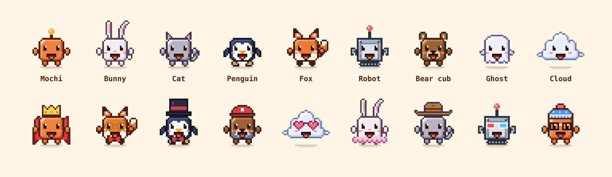

### What's new in 1.32.0

- 🐰🐧🦊🐻☁️ **Five new friends:** bunny (level 2), penguin (4), fox (5), bear cub (8) and cloud (12), each with its own look, lines and habits. The cloud shows its mood as weather: a rainbow when happy, rain when sad.
- 👒 **15 new things to wear:** a beanie, flower crown, cap, cowboy hat, top hat and crown; round, heart, nerd and 3D glasses and a monocle; a bow tie; and **clothes**, a new slot: overalls, a tutu and a superhero cape that hangs behind Mochi.
- The wardrobe is grouped into Hats, Glasses, Neck and Clothes. The outfit editor can make clothes too.
